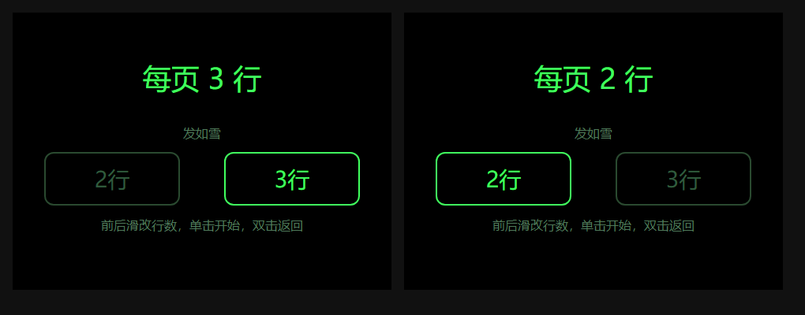
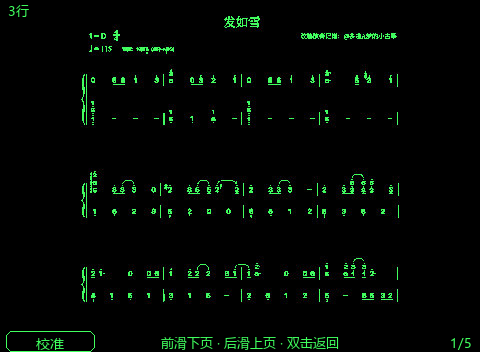

# 古筝演奏琴谱提词器


乐奇眼镜上的演奏投屏。谱在电脑上预先切好，眼镜只贴已经切好的图。黑底绿字，一次一屏。

这块屏的清晰度够不上生谱练琴。它适合已经会的曲子，上台或排练时把当前这一屏放在眼前。暂时不做乐奇智能体商店上架。克隆之后自己导入调试。

谱图有版权，不进这个仓库。打好的 `*.aix` 会把谱图打进去，本机那份真机包也不进公开仓库，避免有人直接下载包取出谱图。

本仓库代码按 [Apache License 2.0](LICENSE) 授权。谱图版权仍归原权利人。

## 自己放谱

谱图放在固定目录：

```text
谱子图片/曲名/01.jpg
谱子图片/曲名/02.jpg
```

只收 jpg。png 可以在下面的页面里上传，页面会转成 jpg 再放下。

在 `preview` 目录执行：

```text
npm install
npm start
```

浏览器打开它印出的地址（默认 `http://127.0.0.1:4877`）。选图、看每一屏，和眼镜一样是 480×352。可以的话再点批准。

批准只写两处，不改你正在用的智能体，也不覆盖本机 aix：

- `dist/aiui-agent`：给乐奇工作室导入的文件夹
- `dist/古筝演奏琴谱提词器-待导入.zip`：同一份的压缩包

没有桌面智能体也能做完。把图放进上面的目录，刷新页面，切屏，再批准。

调号默认 D。要改的话，在页面上传时写调，或改本机 `scores/catalog.json` 里这一首的 `key`。样例是 `scores/catalog.example.json`。本机曲目清单不进公开仓库。

## 装到眼镜

环境要求： 需要支持 AIUI 的乐奇眼镜、乐奇账号、AIUI 工作室及手机端开发者资源包更新权限。不需要企业版功能。

浏览器打开 https://aiui.rokid.com/ ，用乐奇账号登录，本地导入 `dist/aiui-agent`。不要选 zip，不要选仓库根目录，也不要选你还在用的那份源码目录，除非你就是要改它。

名称是「古筝演奏琴谱提词器」。对眼镜说：「乐奇，打开古筝演奏」。

工作室里点 AIX 打包。不上架，不填商店资料。打包之后，在手机 Rokid AI App：设置 → 开发者 → 更新眼镜资源包。

## 眼镜上怎么操作

打开先是选曲。

| 动作 | 选曲 | 每页几行 | 谱已经在眼前 |
| --- | --- | --- | --- |
| 前滑 | 下一首 | 在 2 行和 3 行之间换一项 | 下一屏 |
| 后滑 | 上一首 | 在 2 行和 3 行之间换一项 | 上一屏 |
| 单击 | 进入这一首 | 贴上已经切好的图 | 见下面 |
| 双击 | 离开，回到打开它的助手 | 回到选曲 | 回到「每页几行」 |

选曲和切分都不开麦克风。滑动只改选中，不切谱。



大字是「每页 N 行」。2 行和 3 行分在左右，绿框和亮字是当前选中。没有单独的确认按钮。单击镜腿才进入翻谱。



上面是选好「每页 3 行」、进入翻谱后的示意：谱是《发如雪》第一屏，左上角是行数，左下角绿框是「校准」，中间是操作提示，右下角是屏号。完整曲谱不进仓库。

谱挂上之后，左下角是「校准」。看着琴弦单击一次，记下这个低头的角度，按钮变成「开始演奏」。再单击一次，头控才生效。古筝演奏双手需佩戴玳瑁指甲片，镜腿不太好够，所以用头控；校准起点是看琴弦，不是平视。

头的基准是看琴弦的那一下，不是谱刚出现时的朝向。从基准抬头到大约平视，下一屏。在基准上再往下，上一屏。停在平视不会连翻，回到靠近基准才解锁下一次。左右转头不翻页，看手的时候不会被带走。前后滑仍然各翻一屏。

开始演奏之后，单击留在谱上，不翻页，也不返回。双击只升一级：翻谱回到切分，切分回到选曲，选曲再双击才离开。

底栏可以写操作，不盖住谱。

## 还可以怎么 DIY

把图先切成眼镜分辨率、再打进 AIUI 包这一套，不限于古筝。比如合唱时临时忘词，也可以先把词谱切好投到眼前。那只是一种可改的方向，仓库里并没有合唱模式。合唱多半是平视，若有人要改，抬头低头或许不如左右小幅晃头自然。
